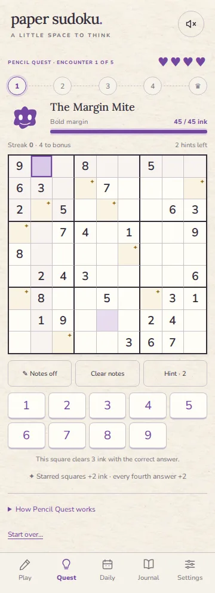
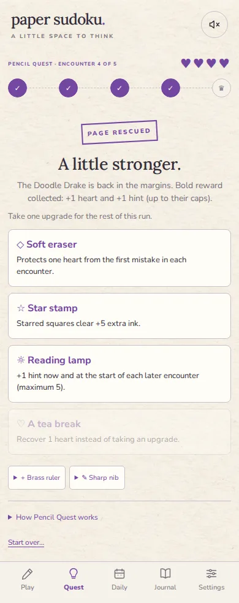

# Pencil Quest — proof of concept

## Intent

Make a small roguelike out of **plain 9 × 9 Sudoku**, with the existing paper notebook and purple highlighter style. Preserve Sudoku deductions and give the player interesting choices about solve order, risk, and upgrades. Start gentle, let a build emerge, finish with a distinct final encounter. No timed input, accounts, currencies, unlock grind, combat turns, or altered Sudoku constraints in this first version.

The mode lives in its own **Quest** tab. Classic, Super, daily archives, ordinary game statistics, and the v1 puzzle bank keep their existing behavior.

## Run plan (implemented)

1. Start with four hearts and two hints.
2. Choose a quiet or bold margin before an encounter. Both use the same unique Sudoku, so the choice has transparent stakes rather than hidden difficulty.
3. Write proven answers to remove ink from the creature. Clear its ink to finish the encounter early; there is no need to finish the whole grid. Fully solving a grid also clears the encounter.
4. Choose one of three seeded, unowned upgrades, or spend the reward on a one-heart tea break. Upgrades last for this run. Four reward screens maximum.
5. Clear five creatures to rescue the notebook, or run out of hearts and start a fresh seeded adventure.

One run is saved on the device, including intermediate reward/route screens. It is included in existing backups and offline caching. Starting over requires confirmation while a run is active. A completed/lost run keeps its summary until the next adventure; this POC has no permanent Quest progression or run history.

| Encounter | Sudoku techniques | Quiet ink | Bold ink |
| --- | --- | ---: | ---: |
| Margin Mite | Naked singles | 36 | 45 |
| Paper Moth | Naked singles | 48 | 60 |
| Blot Twins | Naked / hidden singles | 60 | 75 |
| Doodle Drake | Naked / hidden singles | 72 | 90 |
| Inkkeeper | Naked / hidden singles | 100 | 125 |

The existing generator transforms and verifies the original beginner/easy templates. The seed recipe is `quest-v1:<run seed>:<room>`. Stars and reward offers use separate deterministic streams. This adds replay variety within the existing bank, not entirely new puzzle structures. Nothing changes the immutable v1 daily bank or resolver.

## Rules and decisions

- Correct answer: **3 ink**. It dries in place and cannot be edited or awarded twice.
- Nine starred empty cells per encounter: **+2 ink** when solved.
- Every fourth consecutive correct answer: **+2 ink**.
- Completing a row, column, or box: **+2 ink per unit**, stacking if one answer completes several.
- Selected-cell damage preview includes all active bonuses; it never reveals the answer.
- Wrong answer: **−1 heart**, reset streak, leave the square empty. No cascading bad entries.
- Pencil marks are free, editable, and cleaned up after a correct answer. Keyboard arrows, numbers, N, and Delete work.
- Hint: confirmation before spending; then **write and explain one proven step**. Costs one charge, resets streak, deals no ink damage. Opening confirmation reveals no free answer, and a revealed answer cannot be farmed for damage.
- Bold margin: **25% more ink, rounded up**. On clear, recover **1 heart and 1 hint**, capped at 4 and 5. This creates a longer but potentially restorative path. The final bold path is an optional extra challenge; there is no next upgrade after the boss.

| Upgrade | Effect | Intended use |
| --- | --- | --- |
| Sharp nib | +1 ink per correct answer | Reliable power |
| Purple ribbon | +4 additional ink on every fourth streak answer | Careful play |
| Star stamp | +5 additional ink on starred answers | Choose valuable deductions |
| Brass ruler | +6 additional ink per completed unit | Plan finishing moves |
| Soft eraser | Block the first heart loss each encounter; streak still resets | Forgiveness |
| Reading lamp | +1 hint immediately and on each later encounter, cap 5 | Help when stuck |

Bonus rewards stack additively. No upgrade requires guessing, changes the solution, or removes pencil notes. The lamp is deliberately an assistance option rather than a damage upgrade.

## Balance check

Run `npm run balance:quest` (or `node scripts/quest-balance.mjs 200`). The model enumerates only naked/hidden-single deductions, verifies each against the solution, and then models independent slips. It never selects an unknown solution cell as a move. “Tactical” chooses the highest visible damage among these deductions, prefers damage/protection upgrades, and rests at two or fewer hearts. “Random” chooses among legal deductions and offered upgrades randomly, without resting. “Bold recovery” takes the bold margin when below full health.

Results: **200 seeds per scenario, 1,600 runs total**.

| Policy | Modeled slip chance per attempt | Win rate | Mean correct answers on wins | Mean final hearts on wins |
| --- | ---: | ---: | ---: | ---: |
| Random choices, quiet | 0% | 100% | 63.4 | 4.0 |
| Tactical, quiet | 0% | 100% | 51.4 | 4.0 |
| Random choices, quiet | 3% | 91% | 63.9 | 2.9 |
| Tactical + rest, quiet | 3% | 99% | 55.1 | 3.1 |
| Tactical + rest, quiet | 6% | 84.5% | 58.1 | 2.6 |
| Tactical + rest + bold recovery | 6% | 90% | 61.2 | 3.4 |
| Tactical + rest + bold recovery | 10% | 52.5% | 65.1 | 3.1 |
| Tactical, every path bold | 0% | 100% | 63.4 | 4.0 |

Careful tactical runs take 48–55 correct answers between the 10th and 90th percentiles; random-choice runs take 58–70. Tactical quiet encounters average 8.1, 8.6, 10.7, 11.0, and 13.0 correct answers respectively. This gives a quick first reward and room for power growth without five full Sudoku solves. Choosing valuable squares saves roughly 19% of the writing compared with the random policy, although the policies also differ in upgrade selection.

**Interpretation:** a deliberately forgiving first adventure. Mistakes create tension, and recovery helps, but punishment is not the primary attraction. Bold recovery buys survivability with extra deductions. Keep the current health and ink numbers for this POC rather than force a target failure rate.

**Limits:** these are modeled rules, not measured human win rates or session lengths. The model assumes the player can find every available singles deduction, does not model time, frustration, mis-taps, or the helpfulness of hints, and does not simulate hint usage. It is not evidence that each relic is equally strong or that the game is fun for all players. Automated browser playtesting proves the loop works; a human play session is the next source of pacing feedback. Experienced Sudoku players may find it too easy; harder techniques or enemy-specific effects belong in a later iteration.

## Verification and review notes

- 45 Node tests pass (35 existing + 10 Quest): uniqueness/repeatability, exact stacking, mistake shield, hint costs, no repeated rewards/damage, terminal lockout, complete five-room runs, old backup compatibility, and malformed save rejection.
- Browser playthrough completed all five encounters using actual UI clicks/keyboard and legal deductions, including tea break, relic choices, bold rewards, victory, loss, and fresh runs.
- Confirmed notes/keyboard, restart cancellation, paid hint confirmation without answer leakage, reload persistence, backup export/import, and isolation from Classic/Super.
- Production cache verified offline: reload, continue solving, and generate a fresh run with network disabled.
- Visual checks at 320, 360, 412, and 1440px widths; no horizontal overflow; dark mode and reduced motion; zero captured console/page errors.
- Review fixes: hints reveal answers only after paying; no repeated scoring of dried or hinted answers; correct final-room reward copy; larger keypad targets on narrow phones; text symbol for the ruler to avoid a missing-font glyph.

Optional browser regression command after installing Playwright locally:

```sh
npm run build
node scripts/quest-browser.mjs
```

Use `CHROMIUM_PATH` for a supplied Chromium executable, `PLAYWRIGHT_MODULE` for an externally installed Playwright package, and `QUEST_ARTIFACTS` for screenshots. This harness adds no application runtime dependency. It launches the production preview itself and checks real offline behavior.

## Screenshots

| Encounter on a 360px phone | Upgrade choice |
| --- | --- |
|  |  |
